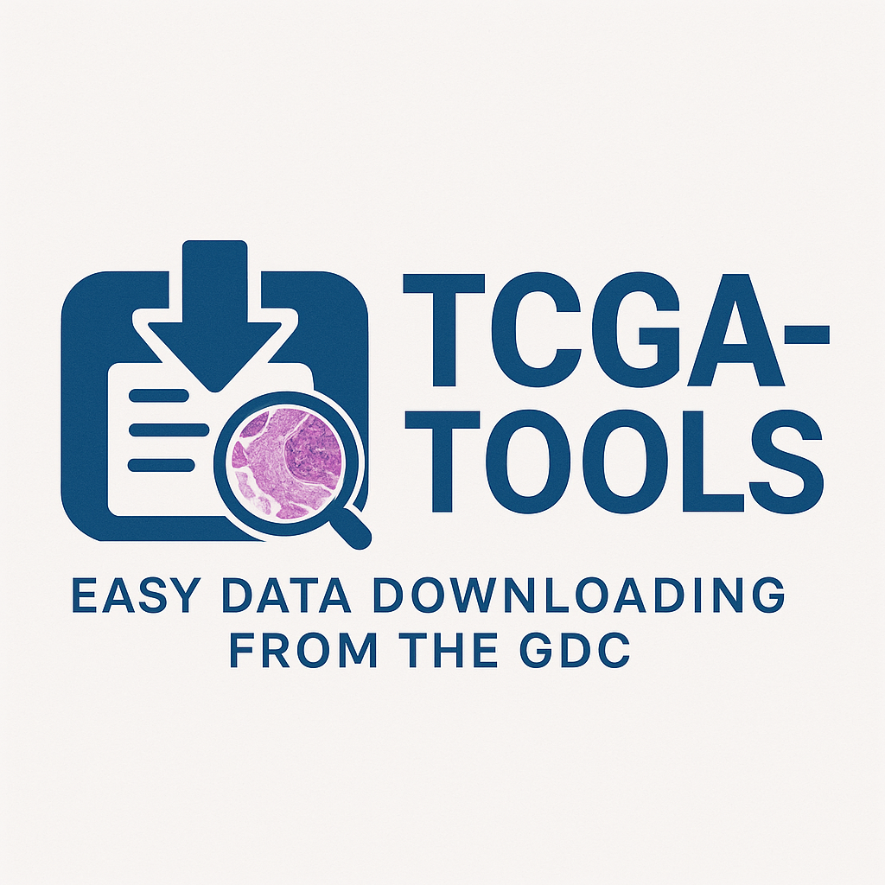

# TCGA-Tools
**TCGA-Tools** is a Python package that provides a clean, modular interface for downloading and organizing datasets from the NCI Genomic Data Commons (GDC), The Cancer Imaging Archive (TCIA), and Patho-Bench metadata hosted on Hugging Face. It allows you to fetch raw data together with directly usable metadata tables and, on the GDC path, optional annotations such as clinical, molecular, diagnostic reports, and diagnosis.

<p align="center">
  
</p>

## Goals
- Simple one-liner to fetch project files (e.g., whole-slide images / `.svs`).
- Write analysis-ready CSVs with file metadata and patient grouping.
- Emit optional annotation CSVs: clinical (survival/outcomes/treatments), molecular (DNA/RNA/CNV/methylation), free-text reports, and diagnosis/subtype.
- Be resilient to missing or sparse fields across projects.

## 🚀 Features
- Source-aware interface for `gdc`, `tcia`, and `patho-bench`.
- Clean, modular architecture with explicit ports/adapters for GDC and TCIA.
- Easy interface to the GDC API and TCIA/NBIA public API.
- Multi-dataset support (download one or multiple TCGA projects at once).
- TCIA imaging collection support with collection listing, modality listing, and series downloads.
- Patho-Bench benchmark metadata support with direct Hugging Face split download plus raw-data access manifests.
- Annotation options:  
  - `clinical`: survival, treatment outcomes, patient metadata  
  - `molecular`: genomic, transcriptomic, and methylation data  
  - `report`: free-text pathology or clinical reports  
  - `diagnosis`: tumor subtype and diagnostic information  
  - `all`: fetch everything available
- Progress bars for downloads.
- Logging of all transformations for reproducibility.
- `raw=True` option for “dry runs” (inspect available data without downloading).
- Optional **statistics** and **visualizations**: class distributions, survival curves, annotation summaries.

## 📦 Installation

### From PyPI (pip)
```bash
pip install tcga-tools
```

### From PyPI (uv)
```bash
uv pip install tcga-tools
```

### Optional Pathology Dependencies (TCIA + GDC wrapper)
```bash
pip install gdc-api-wrapper
```

### From Source
```bash
git clone https://github.com/LUMCPathAI/TCGA-Tools.git
cd TCGA-Tools
pip install -e .
```

## Quickstart
List the available GDC / TCGA projects first:
```python
import tcga_tools as tt

datasets = tt.list_datasets(source="gdc")
print(datasets[["project_id", "name", "summary.case_count"]].head())
```

Preview a single dataset without downloading files:
```python
import tcga_tools as tt

artifacts = tt.download(
    dataset_name="TCGA-LUSC",
    source="gdc",
    datatype=["WSI"],
    annotations=["clinical", "molecular", "report"],
    output_dir="./TCGA-LUSC",
    raw=True,
)
print(artifacts["files_csv"])

# Download multiple datasets
tt.download(
    dataset_name=["TCGA-LUSC", "TCGA-LUAD", "TCGA-BRCA"],  # list of datasets
    source="gdc",
    filetypes=[".svs", ".maf"],                            # multiple file types
    annotations="all",                                     # fetch everything
    output_dir="./TCGA",
)
```

Download actual files instead of only metadata by removing `raw=True`.

Preview a TCIA imaging collection without downloading DICOM ZIP files:
```python
tcia_artifacts = tt.download(
    dataset_name="TCGA-BRCA",
    source="tcia",
    datatype=["MR"],
    annotations=["clinical"],
    output_dir="./TCIA-TCGA-BRCA",
    raw=True,
)
print(tcia_artifacts["files_csv"])
```

Download Patho-Bench metadata for one benchmark dataset and task:
```python
patho_bench_artifacts = tt.download(
    dataset_name="cptac_coad",
    source="patho-bench",
    task_name="KRAS_mutation",
    output_dir="./PathoBench-COAD",
)
print(patho_bench_artifacts["raw_data_manifest_json"])
```

## 🧬 Pathology Portal (TCGA + TCIA)
Use the high-level portal to query pathology metadata and download slides from
TCGA (GDC) and TCIA using clean, modular services.

```python
from tcga_tools.pathology import PathologyDataPortal
from tcga_tools.services.tcia_pathology import TciaSeriesQuery

portal = PathologyDataPortal()

# --- TCIA: SOP Instance lookup and downloads ---
query = TciaSeriesQuery(series_instance_uid="uid.series.instance", format_="JSON")
sop_result = portal.list_tcia_sop_instance_uids(query)
portal.download_tcia_series(series_instance_uid="uid.series.instance", output_dir="./TCIA")

# --- TCGA: download pathology files via GDC wrapper ---
tcga_files = portal.download_tcga_project(
    project_id="TCGA-LUSC",
    filetypes=[".svs"],
    output_dir="./TCGA-LUSC",
)
```

## 📊 Example Outputs (with statistics=True, visualizations=True)

- Summary log of transformations and queries

- Distributions of diagnosis categories

- Survival curves based on clinical annotations

- Counts per file type and annotation

## Outputs 
- `data/` (downloads)
- `files_metadata.csv` (flattened file + case/sample fields)
- `groups.csv` (per-case: paired / tumor_only / normal_only)
- `clinical.csv`, `molecular_index.csv`, `reports_index.csv`, `diagnosis.csv` (if requested)
- `gdc_manifest.tsv` (for the GDC Transfer Tool)
- `patient_studies.csv` (TCIA patient/study metadata)
- `raw_data_manifest.json` (Patho-Bench raw image access instructions)

## Authentication
If you need controlled-access files, set an environment variable with your token:
```bash
export GDC_TOKEN="<your token>"
```

## Finding valid dataset names
Use `list_datasets()` to enumerate the identifiers that can be passed to `dataset_name`.

For GDC / TCGA downloads, these are project IDs such as `TCGA-LUSC`, `TCGA-BRCA`, and `TCGA-LUAD`.

```python
import tcga_tools as tt

df = tt.list_datasets(source="gdc")
print(df[["project_id", "name", "primary_site"]].head(10))
```

Return plain Python records instead of a pandas DataFrame:
```python
projects = tt.list_datasets(source="gdc", as_dataframe=False)
print(projects[0]["project_id"])
```

For TCIA downloads, these are collection names such as `TCGA-BRCA`, `LIDC-IDRI`, or `CPTAC-CCRCC`.

```python
tcia_collections = tt.list_datasets(source="tcia")
print(tcia_collections.head())
```

List TCIA data types (modalities) globally or for one collection:
```python
tt.list_data_types(source="tcia").head()
tt.list_data_types(source="tcia", dataset_name="TCGA-BRCA")
```

From the CLI:
```bash
tcga-tools list-datasets --source gdc --program TCGA
tcga-tools list-datasets --source tcia
tcga-tools list-datasets --source patho-bench --include-data-types
tcga-tools list-data-types --source tcia --dataset TCGA-BRCA
tcga-tools list-data-types --source patho-bench --dataset cptac_coad
```

## Downloading datasets
Use the `dataset_name` argument with one or more IDs returned by `list_datasets()`.

GDC metadata-only dry run:
```bash
tcga-tools download --source gdc --dataset TCGA-LUSC --datatype WSI --raw --out ./TCGA-LUSC
```

Actual GDC WSI download:
```bash
tcga-tools download --source gdc --dataset TCGA-LUSC --datatype WSI \
  --download-workers 4 --out ./TCGA-LUSC
```

Actual GDC RNA-seq metadata and files:
```bash
tcga-tools download --source gdc --dataset TCGA-LUSC --datatype rna-seq --out ./TCGA-LUSC_RNA
```

Multiple GDC projects in one run:
```bash
tcga-tools download --source gdc --dataset TCGA-LUSC TCGA-LUAD TCGA-BRCA \
  --datatype WSI --download-workers 4 --raw --out ./TCGA-WSI
```

TCIA metadata-only preview for one imaging collection and modality:
```bash
tcga-tools download --source tcia --dataset TCGA-BRCA --datatype MR --raw --out ./TCIA-BRCA
```

TCIA metadata-only preview for one patient:
```bash
tcga-tools download --source tcia --dataset TCGA-BRCA --datatype MR \
  --patient-id TCGA-AR-A1AQ --raw --out ./TCIA-BRCA-patient
```

Actual TCIA DICOM ZIP download for one series:
```bash
tcga-tools download --source tcia --dataset TCGA-BRCA \
  --series-instance-uid 1.3.6.1.4.1.14519.5.2.1.3344.4002.142000486987125226950494153345 \
  --out ./TCIA-series
```

For TCIA, `datatype` corresponds to imaging modalities such as `MR`, `CT`, `PT`, `MG`, or `DX`.

Patho-Bench metadata download from Hugging Face:
```bash
tcga-tools download --source patho-bench --dataset cptac_coad \
  --task KRAS_mutation --out ./PathoBench-COAD
```

Patho-Bench metadata for a full benchmark dataset:
```bash
tcga-tools download --source patho-bench --dataset bracs --out ./PathoBench-BRACS
```

Patho-Bench metadata plus delegated raw-image download when the dataset is TCIA-backed:
```bash
tcga-tools download --source patho-bench --dataset cptac_coad \
  --download-raw-data --out ./PathoBench-COAD-full
```

Patho-Bench contains only metadata splits and labels on Hugging Face. Raw image downloads still come from the original dataset portals. For CPTAC-style entries already hosted on TCIA, `--download-raw-data` delegates to the TCIA backend. For the remaining Patho-Bench datasets, the downloader writes a `raw_data_manifest.json` with the original access URL.

## Efficient batched downloading
The downloader is now designed for bounded parallel transfers within each dataset or imaging collection.

- Use `dataset_name` as a list to process multiple datasets in one run.
- Use `--download-workers` or `download_workers=` to control parallel file or series downloads.
- Keep worker counts modest on login nodes; values like `2` to `4` are usually appropriate there.
- On dedicated transfer or batch nodes, increase the worker count if the filesystem and network can sustain it.
- For very large GDC runs, `--tar` can still be preferable when one archive per dataset is easier to manage than many parallel file transfers.

## Annotations argument
Pass any subset of:
- `"clinical"` — survival/clinical outcome/treatment effect (diagnoses, treatments, follow-ups, exposures)
- `"molecular"` — DNA/RNA/CNV/Methylation file index
- `"report"` — free-text/clinical/pathology reports (XML/PDF)
- `"diagnosis"` — diagnostic subtype, morphology, stage/grade
- `"all"` — everything above

On the GDC path, these map to GDC case/file annotations.

On the TCIA path, only `clinical` is supported, and it is limited to patient/study metadata returned by the public imaging API. TCIA does not expose a standardized public cross-collection API for GDC-style molecular, report, or diagnosis tables.

On the Patho-Bench path, benchmark tasks are selected with `task_name` / `--task` instead of the `annotations` argument. The Hugging Face repo stores split TSVs and YAML metadata only.

## Handling missing data
GDC projects vary in completeness. TCGA-Tools is defensive:
- Broad field requests; if the API rejects fields (HTTP 400), it **retries without fields** to maximize returned content.
- JSON is **flattened** into wide CSVs; absent fields simply do not appear, or appear with empty values.
- Grouping logic remains robust even if sample types are missing.

## CLI
```bash
tcga-tools download --source gdc --dataset TCGA-LUSC --datatype WSI \
  --annotations clinical molecular report diagnosis --raw --out ./TCGA-LUSC
```

Show all valid TCGA project IDs:
```bash
tcga-tools list-datasets --source gdc --program TCGA
```

Show all valid TCIA collection IDs and modalities:
```bash
tcga-tools list-datasets --source tcia
tcga-tools list-data-types --source tcia --dataset TCGA-BRCA
```

Show all valid Patho-Bench benchmark datasets and tasks:
```bash
tcga-tools list-datasets --source patho-bench --include-data-types
tcga-tools list-data-types --source patho-bench --dataset cptac_coad
```

The legacy form is still supported:
```bash
python -m tcga_tools --dataset TCGA-LUSC --datatype WSI --raw --out ./TCGA-LUSC
```

Validate an existing output directory offline:
```bash
tcga-tools validate-output ./TCGA-LUSC --dataset TCGA-LUSC
```

## Requirements
- Python ≥ 3.9
- Tested on Linux, macOS, Windows
- Dependencies are listed in `pyproject.toml` and installed automatically.

## Logging
All downloads and transformations are logged to `download.log` in your output directory for reproducibility.

## Raw mode
Preview available data without downloading:
```python
tt.download(dataset_name="TCGA-LUSC", raw=True)
```

## Testing
Run unit tests:
```bash
pytest tests/
```

## Notes
- For very large downloads, prefer the emitted `gdc_manifest.tsv` with the GDC Data Transfer Tool.
- Extend `config.py` to add/modify field lists or filetype preferences as needed.

## License

Apache 2.0 — free for research and commercial use.

## Contributing

Contributions are welcome! Please open an issue or PR on GitHub.
